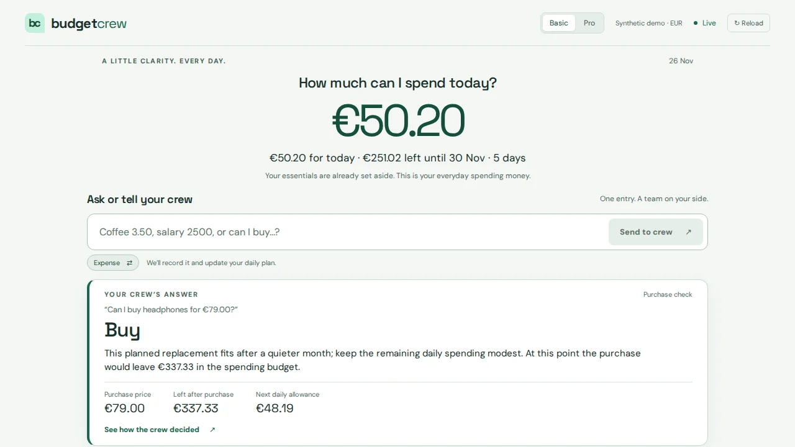
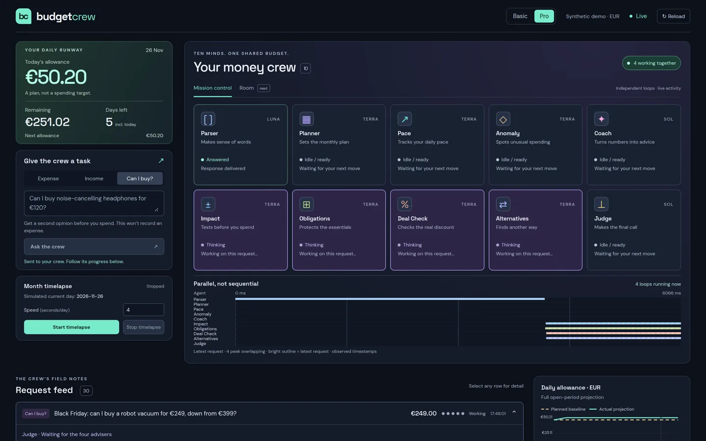

# Daily Budget Crew

A crew of concurrent [Mozaik](https://www.npmjs.com/package/@mozaik-ai/core) agents around a daily budget. Built for the JigJoy Black Friday AI Hackathon (track: AI agents in finance). All data is synthetic.

Live demo: https://budget-crew.smirnoff.pro (landing) and https://budget-crew.smirnoff.pro/app (the app).



## What it does

Your salary minus fixed bills, divided by the days until the next payday, is what you can spend today. Every expense changes that allowance for the remaining days. Daily Budget Crew tracks it and puts a team of AI advisers around it:

- **Log money in plain text.** "coffee 3.50", "salary 2400", "freelance 300". Parser turns it into an expense or an income; Ledger recalculates the daily allowance. Pace, Anomaly and Coach comment on expenses; Pace and Coach comment on income.
- **Ask before you buy.** "Can I buy a jacket for €90?" Four advisers check it at the same time: Impact (effect on your daily allowance), Obligations (bills still due), Deal Check (whether the Black Friday discount is real, using price history and web search), Alternatives (cheaper options or reasons to wait). Judge reads their verdicts and answers buy, wait or skip.
- **Watch a month.** The timelapse replays a synthetic November at four seconds a day, with Black Friday purchases near the end, while the crew answers in real time.

Basic mode shows one clear answer; Pro mode shows every agent, its verdict and the loops running at that moment.



## How the agents run concurrently

There is no orchestrator. Each agent is a Mozaik participant with its own `SituationSpecification`s: it reacts to relevant runtime events and starts `runLoop` without `await`, so agents reacting to the same event run in parallel.

|Event|Agents that start at the same time|
|---|---|
|`expense.recorded`|Pace, Anomaly, Coach|
|`income.recorded`|Pace, Coach|
|`period.started` (salary)|Planner, Obligations|
|`purchase.parsed`|Impact, Obligations, Deal Check, Alternatives|
|`purchase.ready`|Judge|

- **Shared state, one writer.** All agents read the same `BudgetState` (a Mozaik `RuntimeState`) through tools. Only the non-LLM participant Ledger writes it: it records money, opens and closes periods and stores each agent's verdict in that agent's own slot, so parallel answers never overwrite each other.
- **Coordination through events.** Ledger emits `purchase.ready` once all four adviser slots are filled; a stuck adviser is marked `failed` after 75 seconds and Judge decides with what it has.
- **No shared memory between loops.** Each `runLoop` gets a fresh context with one request, so two loops of the same agent (two purchases, or Obligations serving a salary and a purchase) do not mix.
- **Code computes money.** Budget math is deterministic TypeScript in `packages/budget` with tests; agents get figures only through tools (`simulate_budget`, `upcoming_obligations`, `price_history`, `web_search`).
- **Visible concurrency.** Observer publishes every loop phase (received, thinking, tool, answered) to Centrifugo; the Pro view and the timelapse show the overlapping loops. During the timelapse the clock never waits for agents, so loops of different days overlap too.

Models: `gpt-6.2-sol` for Judge and Coach, `gpt-6.1-terra` for the advisers, `gpt-6-luna` for Parser. Design details: [docs/architecture.md](docs/architecture.md).

## Built during the hackathon

Everything in this repository was written on 26–27 November 2026 (see the commit history). `reference/daily-projection.ts` is the author's earlier description of the daily-allowance algorithm, kept for reference: the math was rewritten in `packages/budget` and nothing imports from `reference/`.

## Quick start

You need [Docker](https://docs.docker.com/get-docker/) with Compose v2 and Git.

```sh
git clone https://github.com/yozzh/budget-crew.git
cd budget-crew
docker compose up --build -d --wait
```

Open http://localhost:3000/app (landing page at http://localhost:3000). The first
build takes a few minutes. Without a `.env` the crew runs offline on deterministic
stub answers: every screen and the month timelapse work, no API key is needed.
Stop with `docker compose down`.

### Install wizard

With Node 20 or newer on the machine, the wizard checks prerequisites, asks a few
questions, writes `.env`, starts the stack and waits until it is healthy:

```sh
node scripts/install.mjs          # interactive
node scripts/install.mjs --yes    # all defaults: Docker, offline stub crew
```

It offers Docker mode (as above) or Node mode (API and Vite on the host for
development), offline or live OpenAI models (key input is hidden), optional
Mozaik cloud telemetry, and picks free ports when 3000 or 8000 are taken.
Re-run it to reconfigure; it stops the previous containers first.

### Live models by hand

```sh
cp .env.example .env
# set INFERENCE=live and OPENAI_API_KEY=sk-...
docker compose up --build -d --wait
```

`OPENAI_BASE_URL` may point at any OpenAI-compatible Responses endpoint. From
inside Docker, a proxy on your machine is `http://host.docker.internal:<port>/v1`,
not `localhost`.

|Variable|Default|Meaning|
|---|---|---|
|`INFERENCE`|`stub`|`stub` offline answers, `live` real models|
|`PUBLIC_DEMO`|`false`|Enable public-demo live inference limits|
|`LIVE_LIMIT_PER_IP_PER_HOUR`|`10`|Live submissions per client IP per hour in public demo mode|
|`LIVE_LIMIT_PER_DAY`|`300`|Live submissions globally per day in public demo mode|
|`OPENAI_API_KEY`|empty|Required for `live`|
|`OPENAI_BASE_URL`|api.openai.com|OpenAI-compatible endpoint|
|`MOZAIK_API_KEY`, `MOZAIK_PROJECT_ID`|empty|Optional Mozaik cloud telemetry|
|`APP_PORT`|`3000`|Browser port of the Docker stack|
|`CENTRIFUGO_PORT`|`8000`|Centrifugo on 127.0.0.1 (used by Node mode)|
|`CENTRIFUGO_API_KEY`|`budget-crew-local`|Shared by the app and Centrifugo|

### Node mode (development)

Node 24 and pnpm 12 (`corepack enable`); Centrifugo still runs in Docker.

```sh
cp .env.example .env
pnpm install --frozen-lockfile
pnpm build
docker compose up -d --wait centrifugo
pnpm start            # API on :3000, reads .env
pnpm dev              # second terminal: Vite on http://localhost:5173/app
```

Vite proxies `/api` to `PORT` (3000) and `/connection` to `CENTRIFUGO_PORT` (8000);
export them for `pnpm dev` if you changed them in `.env`.

### Troubleshooting

- Status stays "Reconnecting": Centrifugo is not reachable; check `docker compose ps`.
- Port in use: set `APP_PORT=3100` (or `CENTRIFUGO_PORT`) in `.env`, or run the wizard.
- `/api/health` reports the running mode: `{"status":"ok","inference":"stub"}`.

Checks: `pnpm lint && pnpm typecheck && pnpm test && pnpm build` (tests never call a real model).
The public demo uses `deploy/public/compose.yaml` ([runbook](deploy/public/README.md)); the internal stand uses `deploy/compose.yaml`.

## Web dashboard

The English app at `/app` (landing page at `/`) accepts expenses, incomes and purchase checks and
shows server-projected daily allowances, verdict cards and concurrent agent loops.
`centrifuge` v5 subscribes anonymously to `crew:state` and `crew:activity` at the
same host's `/connection/websocket` (secure WebSocket on HTTPS).
Vite proxies `/api` to port 3000 and `/connection` to Centrifugo on port 8000.
Without snapshot stream positions, the client resynchronizes after subscribing,
buffers publications during fetches and discards pre-reset snapshot responses.
The Reload button retries a failed snapshot fetch; connection recovery is automatic.

### Month timelapse

Start/Stop controls replay the synthetic November in `seed/month.json`.
Speed is seconds per day (default 4, about two minutes per month).
The fixture spends €1,280 before Black Friday, leaving €300 and a €75 daily
allowance on November 27. Four purchase checks contrast a cheap real discount,
an affordable weak deal and an over-budget purchase; live Judge decisions vary.
`POST /api/simulation` accepts `{}` or `{ "speed": 0.05 }` and returns 202;
another start while running returns 409. `DELETE /api/simulation` stops it.
Start resets the profile without an open period; the day-one salary goes
through Parser/Ledger to open it. The clock never waits for agent loops.
Natural completion publishes `simulation.finished`; pending agents may finish
afterwards. Stop, reset and shutdown invalidate outstanding simulated work.
The SVG compares the original salary plan with the API's full current projection,
including extra income and redistribution after expenses.
On restricted local runners, `TEST_PORT=25233 pnpm test` pins the integration
HTTP listener instead of using an ephemeral port.

## Budget state

`GET /api/state` returns the in-memory snapshot and the latest 50 requests.
The synthetic Alex/EUR seed opens a period in the current UTC month; all money
is integer euro cents. Restarting or `POST /api/reset` restores this seed.
Reset responds with 204 after publishing `state.reset` on `crew:state`.
Set `CENTRIFUGO_API_URL` and `CENTRIFUGO_API_KEY` for delivery;
reset publication failures are surfaced as HTTP errors.

`BudgetModule` exports the single `BudgetStore`. Runtime consumers must use
`store.state` (a Mozaik `RuntimeState`) rather than construct a second state;
reset preserves that object's identity and its participant registry.
`snapshot()` returns an isolated copy; the store retains at most 200 requests.
Contracts and strict agent-output JSON schemas are exported by
`@budget-crew/shared`. Stream positions are intentionally not included yet.

Purchase advisers receive the stored submission-date simulation, not the live
budget. Obligations reads the original period's unpaid bills over 30 days and
uses code-computed post-purchase coverage: negative margin → stop, less than
seven pre-purchase daily allowances → warn, otherwise ok. Bills are already
reserved by the budget engine; subtracting them again is deliberately conservative.
The shared `upcoming_obligations` tool returns euro-formatted `remaining` and
`remainingAfterObligations`. Alternatives uses the stored next-allowance change;
an absent next allowance means the final period day, not an unknown budget.

## Crew runtime

`INFERENCE` is validated at startup and defaults to `stub`; health reports the
validated mode. `live` requires `OPENAI_API_KEY` and supports `gpt-6-luna`,
`gpt-6.2-sol` and `gpt-6.1-terra`. `OPENAI_BASE_URL` points all three at an
OpenAI-compatible Responses endpoint, such as a local CLIProxyAPI logged in with
a Codex subscription. Stub loops never enable Mozaik cloud telemetry,
even when credentials are present.

Join participants through `CrewRuntime.join`, dispatch custom events through
`sendEvent`, and call `startLoop(agent, requestId, message, structuredOutput,
tools?, model?)` from their processors without awaiting. Each loop gets a fresh
developer/user context; agent memory is not reused.

Before starting a stub loop, register its named output using
`StubInferenceRunner.registerFixture(name, zodSchema, value, functionCall?)`.
Fixtures are validated when registered; unknown schema names fail explicitly.
The optional function call is `{ name, args }` and executes at most once per loop.
Stub inference waits 50–400 ms per turn so overlapping loops remain observable.
The default parser fixtures also recognize the synthetic month's euro amounts,
expense categories and purchase names; explicitly registered fixtures override
this offline grammar.

Observer publishes versioned `agent.activity` envelopes to `crew:activity`;
`requestId` follows the loop's `[req:…]` prefix. Prompts and answers are not
included in summaries. Set `CENTRIFUGO_API_URL` (default
`http://127.0.0.1:8000/api`) and `CENTRIFUGO_API_KEY` for delivery; publication
failures are logged without stopping loops.

## Live crew evaluation

`apps/api/src/eval/scenarios.ts` holds synthetic financial situations with the
answer a careful adviser would give (parsed amounts, verdict levels, the Judge's
decision); `H*` scenarios are hold-outs that were not used to tune prompts.
`pnpm --filter @budget-crew/api eval:live` runs them on real models; it is never
part of `pnpm test` or CI and skips unless `INFERENCE=live` and `OPENAI_BASE_URL`
are set. Options: `EVAL_ONLY` (comma-separated ids), `EVAL_REPEATS`,
`EVAL_WORKERS`, `EVAL_LABEL`. Each run checks parsing, verdict levels, decisions,
adviser completion and that every euro string an agent outputs was supplied to
it, and writes `apps/api/eval-reports/<time>-<label>/` (git-ignored) with
`summary.md` and full call transcripts in `results.json`.
